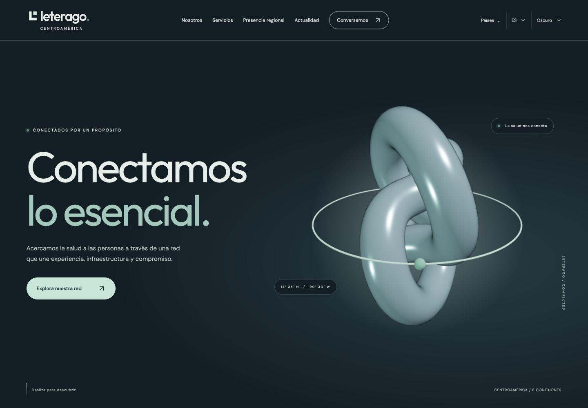
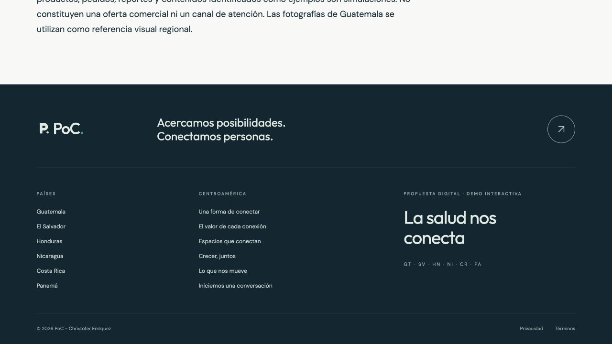

# Verificación final local

Fecha: 2026-11-02.

`pnpm check` completó correctamente: 496 pruebas, cobertura, compilación y auditoría HTTP del artefacto.

| Métrica V8    | Cubierto | Total | Cobertura |
| ------------- | -------: | ----: | --------: |
| Instrucciones |     2020 |  2020 |      100% |
| Ramas         |      356 |   356 |      100% |
| Funciones     |       71 |    71 |      100% |
| Líneas        |     2020 |  2020 |      100% |

Umbral exigido por configuración: 95% en cada métrica. Ámbito: todos los archivos JS/JSX de `src`.

Auditoría estática: 24 archivos servidos, 0 faltantes y 164 URLs localizadas bajo `/poc_website/`.

La compilación de producción se abrió en navegador en una ruta profunda de catálogo en inglés y se recargó correctamente. No se observaron errores de consola en esa comprobación. Se revisó también la portada con WebGL real.

Ver [matriz de escenarios](test-matrix.md) para detalle y límites. No se efectuó publicación remota.

Modo claro/oscuro/sistema verificado adicionalmente con 328 combinaciones de ruta/idioma/tema, siete formularios en ambas apariencias y 30 pares de contraste. Casos de almacenamiento bloqueado, datos inválidos, sincronización de pestañas, preferencia del sistema y conservación de borradores/foco incluidos. Ver [contrato del tema](theme.md).

Banderas: seis SVG locales verificados en el selector y desplegable, cajas de 15 × 15 px, carga correcta bajo `/poc_website/`. Cambio GT → CR y tema claro comprobados a 320 px sin desbordamiento. Suite: 496 tests; cobertura JS/JSX 100% en las cuatro métricas.

## Marca PoC y parallax

Cambios del 2026-11-02: marca PoC en interfaz/metadata, nuevo símbolo P y favicon, y footer exacto `© 2026 PoC - Christofer Enríquez` en ES/EN. Las 328 combinaciones de rutas, idiomas y temas comprueban el footer y la ausencia de Leterago en el texto del DOM. No se retocaron marcas incrustadas en las fotografías de referencia.

Parallax en fotos grandes: `yPercent` de -8 a 8, scrub de 0.6, imagen al 124% dentro de un marco con recorte. Pruebas de selección de imágenes, marcos vacíos, ausencia de API, movimiento reducido y cambios de ruta/preferencia. El hook usa `revertOnUpdate` para gestionar los efectos al navegar.

Verificación real: transformación de la foto de país cambió con el scroll tanto en escritorio como en móvil de 390 px; las fotos siguieron cubriendo el marco completo. Sin desbordamiento horizontal a 390 px. Marca y footer visibles, también en inglés.

Preparación de publicación: instalación con lockfile verificada, 496 tests y `pnpm check` exitosos. Build con dos WOFF2 variables (69,224 bytes), un CSS y 24 archivos servidos sin faltantes. Ver [despliegue y versiones](../github-pages.md).
